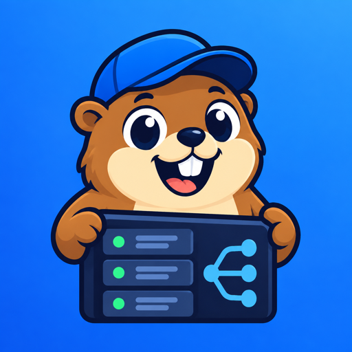
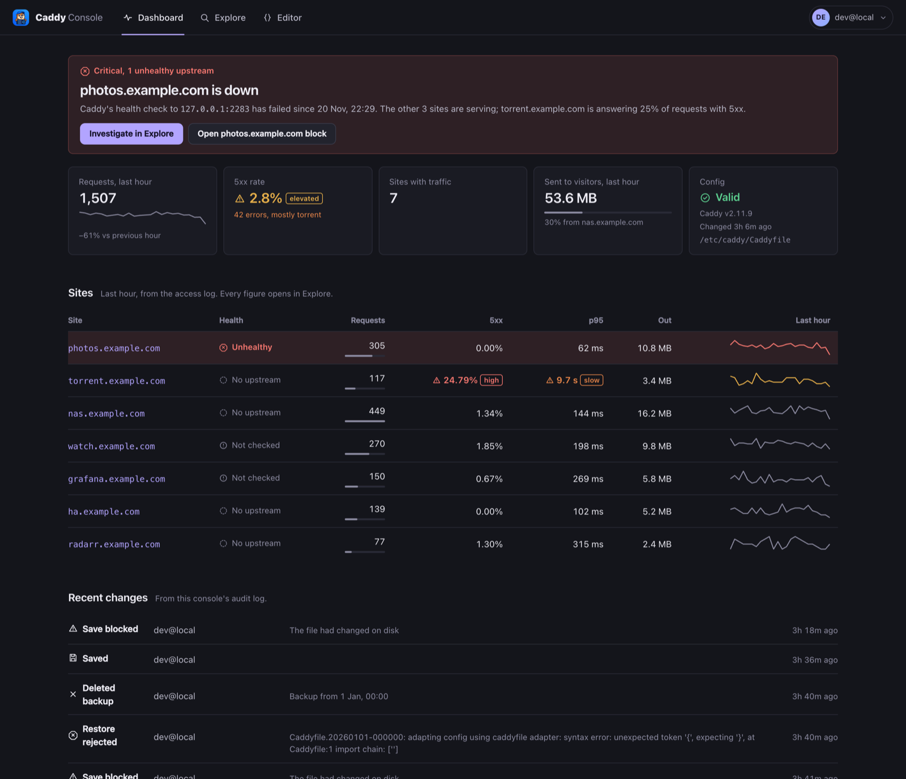
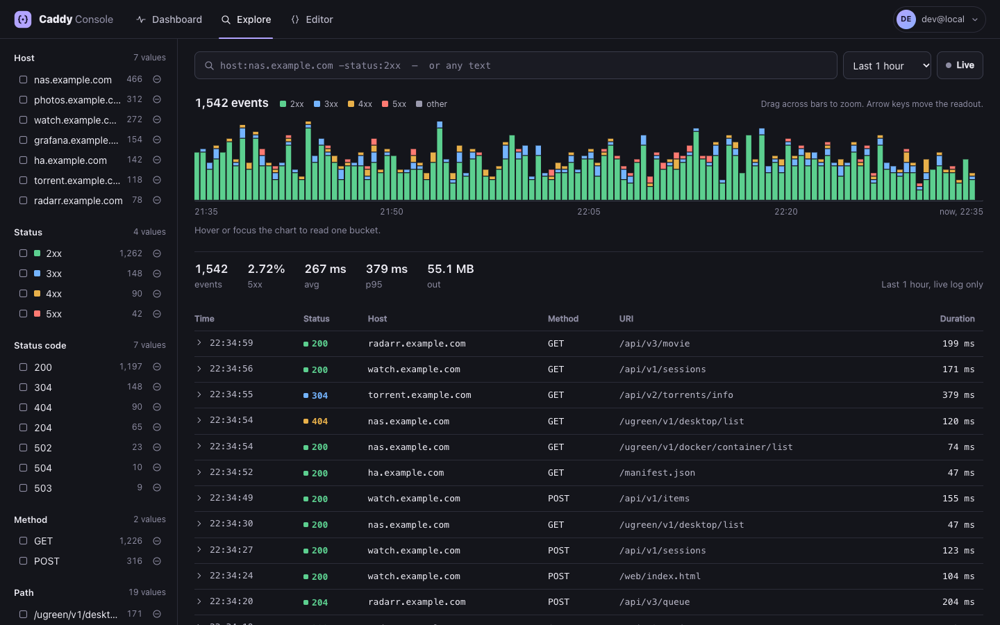
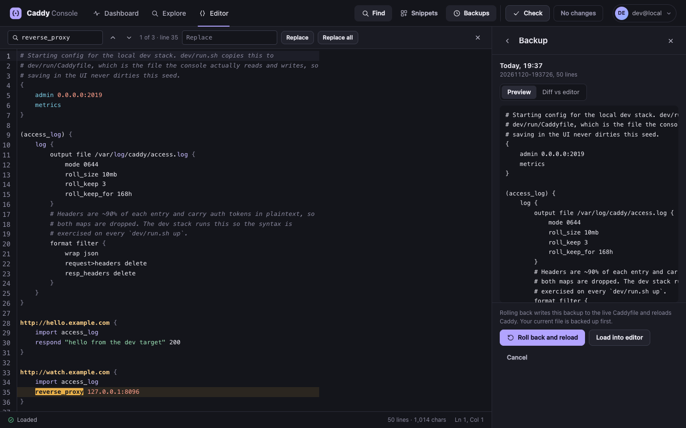

# Caddy Console

A console for a self-hosted Caddy: edit the Caddyfile, save and reload with no
downtime, and see what your sites are actually doing — read from Caddy's own access
log, with no database and nothing to keep in sync.

Three views, each with its own URL. Light and dark themes (it follows the OS; override
it in the account menu), and it works on a phone.

## Dashboard — is anything broken?

It opens on a verdict: what is broken, since when, and one click to Explore or to
the affected site's block in the Caddyfile. Under it, tiles for requests (with a
trend and the change against the previous hour), the 5xx rate, sites with traffic,
bytes sent to visitors (with the top site's share) and the config state.

The sites table lists problems first: down, then high 5xx, then slow. Health reads
"Not checked" for a site with no health check configured. **Every figure is a
link** into Explore with that filter already applied, so "torrent is at 21% errors"
is one click from the requests that caused it. Recent changes (from the console's
audit log) sit below. If almost all requests come from a Docker network address,
a notice says real visitor IPs are not being logged and how to fix it.



## Explore — why is it broken?

Faceted search over the access log. Type `host:… status:5xx path:/api client:1.2.3.4`, or plain
text, or prefix a term with `-` to exclude it — `-status:2xx` is everything that
did not go well. Each facet value has a checkbox (only this) and an exclude button
(everything but this); excluded values are struck through and tagged. Counts update
with your filters, and a count always equals what clicking it returns. Drag the
histogram to zoom into a spike, or use the arrow keys to move its readout.



The whole view lives in the URL — filters, range, absolute timestamps — so a link
reproduces exactly what you were looking at. Ranges run from 30 minutes to 30 days;
older ranges are served by reading Caddy's rolled `.gz` archives, so how far back
you can look is simply how much `roll_keep` has kept.

Expand an event for its fields, each with a menu to filter, exclude or copy — plus
the original log line, formatted. Click the client IP to see where it is from — city, country
and network, from a local DB-IP database that updates itself monthly — and what
else that IP did: its hosts, paths and status mix, each one click from a filter.
Behind Cloudflare, add the opt-in `log_append` lines from
[docs/setup.md](docs/setup.md) and you also get a Country facet (`country:RO`) and
each event's Ray ID, with a copy button.


## Editor — fix it

CodeMirror 6 with Caddyfile syntax highlighting, find and replace, and `Cmd+S` to
save. A warnings strip links to the offending lines: a file that is not formatted,
or an upstream that could not be resolved from the console container. **Check**
formats the file and verifies syntax and module availability without saving;
**Save & Reload** shows a diff of only your changes, then asks Caddy to perform its
full transactional load. Every save takes a backup first; Backups lets you preview,
diff and roll back. Snippets inserts common Caddyfile patterns, and the account menu
switches the editor to a Vim keymap.



## Quick start

```bash
git clone https://github.com/ViralOne/caddy-console.git
cd caddy-console
cp .env.example .env          # set CADDY_CONSOLE_IMAGE and authentication values
chmod 600 .env
sudo mkdir -p /opt/caddy
# write /opt/caddy/Caddyfile (example in docs/setup.md), then:
sudo chown -R 10001:10001 /opt/caddy  # console image runs as UID/GID 10001
sudo chmod 0755 /opt/caddy && sudo chmod 0644 /opt/caddy/Caddyfile
docker compose -f docker-compose.prod.yaml up -d
```

### Deploying (Portainer or plain Docker)

- **Caddyfile lives at `/opt/caddy/Caddyfile` on the host.** It is gitignored, so
  create it before the first deploy; otherwise Docker mounts an empty directory.
- **Port choice is deployment-specific.** The temporary internal stack publishes
  Caddy on 8080/8443 so it can run beside Nginx. The production stack claims host
  ports 80/443 after cutover. Do not run both stacks simultaneously.
- **Never forward 9090, 8888 or 2019.** The unauthenticated Caddy admin API is
  reachable only on the dedicated `caddy-admin` network shared by Caddy and the
  console. Do not attach other services to that network.
- **Environment:** set variables in the Portainer stack (or a mode-`0600` `.env`
  next to the compose file). `CADDY_CONSOLE_IMAGE` and the tunnel token are
  required by Compose; authentication settings are validated by the app.

### Internal stack (temporary, no login)

`docker-compose.internal.yaml` runs the console without any login, for temporary
transition work only. Its synthetic-login proxy is bound to `127.0.0.1:8888`;
open `http://localhost:8888` on the host or use an SSH local port forward from an
administrator workstation.

Anyone who reaches that loopback port is a full admin: they can rewrite and reload
the Caddyfile, so they control every site Caddy serves. `console-proxy` logs every
visitor in as `admin@local` through the explicit
`UNSAFE_ALLOW_UNVERIFIED_CF_HEADER` escape hatch. Production Cloudflare mode has
no fallback and refuses to start unless Access JWT verification is configured.
Switch to `docker-compose.prod.yaml` as soon as Google OAuth or Cloudflare Access
is ready.

Two things to do next, both in [docs/setup.md](docs/setup.md):

1. **Pick an auth mode** — Google OAuth, or Cloudflare Access in front of it.
2. **Turn on access logging** with `format filter`, so the dashboard and explorer
   have data — and so your logs do not contain plaintext session tokens.

## Docs

| | |
|---|---|
| [Setup](docs/setup.md) | Deploying it, auth modes, access logging, retention, environment variables, API reference |
| [Migrating to Cloudflare Tunnel](docs/migration-tunnel.md) | nginx + port forwarding → Caddy + tunnel, old Route53 domain via Cloudflare for SaaS, Google login |
| [Development](docs/development.md) | Local no-auth stack, seeding log data, tests, front-end build |
| [Architecture](docs/architecture.md) | Why there is no database, how the log is indexed, why Preact for two views |

## Also in here

- **Backups** — taken before every save, with preview, inline diff and restore
- **Audit log** — who changed what, surfaced on the dashboard
- **Snippets** — common Caddyfile patterns to insert
- **Upstream health** — from Caddy's active health checks

## Requirements

Docker, and a Caddy instance with its admin API reachable only from the console's
dedicated `caddy-admin` network (`admin 0.0.0.0:2019` inside the container global
block). Nothing else: app code ships as plain ES modules, so there is no build step
and a clone needs no npm.
